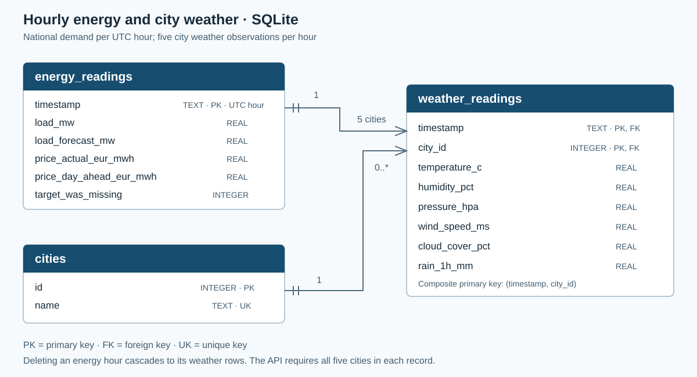

# Database design

The project models Spain's national hourly electricity demand alongside weather observations from five cities. Demand is national: the design does not assign a share of electricity demand to individual cities. SQLite and MongoDB Atlas store the same cleaned source observations and expose the same API payload.

## Source data and preprocessing

The original files are `data/energy_dataset.csv` and `data/weather_features.csv`. Importing uses `src/preprocessing.py` and leaves the standalone notebooks unchanged. It reproduces the modeling export's UTC parsing, stable duplicate removal, selected generation zero-dropout handling, invalid weather rejection, Kelvin-to-Celsius conversion and forward filling with a leading-gap backfill. The EDA notebook continues to use interpolation for its own descriptive analysis.

The persistence model selects actual demand, operator demand forecast, actual/day-ahead prices and the six weather measurements used in the existing analysis. Generation columns are cleaned consistently but are not persisted or supplied to the forecasting model. `target_was_missing` records which demand values were imputed from the raw source.

All database timestamps identify whole UTC hours. API inputs require an explicit timezone and are normalized to UTC. Madrid local time is used only when deriving model calendar features. A date range is always `[start, end)`, and returned records are ordered from earliest to latest. Daily summaries group by UTC date and return observation counts, including partial days.

## SQLite relational schema

The editable diagram source is [erd.mmd](erd.mmd), and the executable schema is [schema.sql](../sql/schema.sql).

| Table | Primary key | Purpose |
|---|---|---|
| `energy_readings` | `timestamp` | One national energy observation per UTC hour |
| `cities` | `id` | Five unique city names |
| `weather_readings` | `(timestamp, city_id)` | One weather observation per city per energy hour |

`weather_readings.timestamp` references `energy_readings.timestamp` with `ON DELETE CASCADE`; deleting an hourly record also removes its five weather rows. `weather_readings.city_id` references `cities.id`. The API requires all five different cities in every complete observation. SQLite constraints enforce unique keys, valid city names, positive actual demand and bounded weather measurements.

Timestamps are stored in one canonical text format, `YYYY-MM-DDTHH:00:00Z`, so key ordering is chronological. The energy primary key supports exact, latest and range queries. The weather composite primary key supports joining each hour's five cities; the additional `(city_id, timestamp)` index supports city history. Foreign keys are enabled on the repository connection.

The `hourly_summary` view joins energy observations to weather and calculates `AVG(temperature_c)` as `temp_mean_c`. Mean temperature is derived from the city readings instead of storing a second copy that could become stale. POST, PUT, DELETE and each complete SQLite import execute transactionally. PUT replaces child weather rows in the same transaction as the energy update.

Three executable query examples are in [queries.sql](../sql/queries.sql): latest record, an inclusive-start/exclusive-end range, and daily demand aggregates. Their executed results are recorded in [query_results.md](query_results.md).

## MongoDB collection design

Atlas uses a standard collection named `hourly_records` in `energy_pipeline`. One document represents one energy hour and embeds exactly five weather objects. This keeps a complete hourly observation together, so replacing or deleting one hour is a single-document operation.

The document `_id` is the canonical timestamp string, while `timestamp` is a BSON UTC Date for date queries and aggregation. A unique ascending `timestamp` index also prevents duplicate hours. The [collection validator](../mongodb/schema.json) checks required fields, numeric bounds, five distinct expected cities, whole-hour timestamps, and agreement between `_id` and `timestamp`. It is installed by the repository or [setup script](../mongodb/setup.js).

| Field | Type | Meaning / unit |
|---|---|---|
| `_id` | string | Unique canonical UTC hour; internal to MongoDB |
| `timestamp` | BSON Date | Hour being observed |
| `load_mw` | number | Actual national demand, MW; positive |
| `load_forecast_mw` | number or null | Operator demand forecast, MW; nonnegative |
| `price_actual_eur_mwh` | number or null | Actual electricity price, EUR/MWh |
| `price_day_ahead_eur_mwh` | number or null | Day-ahead electricity price, EUR/MWh |
| `target_was_missing` | boolean | Whether raw actual demand was missing before filling |
| `weather` | array of five objects | One object for each required city |

Each weather object has these fields:

| Field | Type | Validation / unit |
|---|---|---|
| `city` | string | Barcelona, Bilbao, Madrid, Seville or Valencia |
| `temperature_c` | number | Celsius, between −100 and 70 |
| `humidity_pct` | number | Relative humidity, 0–100% |
| `pressure_hpa` | number | Pressure, 900–1100 hPa |
| `wind_speed_ms` | number | Wind speed, 0–50 m/s |
| `cloud_cover_pct` | number | Cloud cover, 0–100% |
| `rain_1h_mm` | number | Rainfall over one hour, at least 0 mm |

The same field names and validation apply to the API and SQLite repository. API JSON uses an ISO UTC timestamp and omits MongoDB's internal `_id`. [Sample documents](../mongodb/sample_documents.json) use MongoDB Extended JSON (`{"$date": "…"}`) to represent BSON dates; the API accepts a normal ISO timestamp string instead.

Three MongoDB query examples are in [queries.js](../mongodb/queries.js): latest record, a date range and daily demand aggregates. See [query_results.md](query_results.md) for executed results. Running the queries against Atlas requires its connection URI and an allowed client IP address.

## CRUD and forecasting consistency

`src/schemas.py` defines complete observation validation once. Both repositories consume the same validated records, and `src/api.py` provides the same operations under `/sql` and `/mongo`. Each record is addressed by its timestamp; PUT cannot move a record to another hour. A duplicate POST is a conflict. Missing records and invalid input receive consistent API errors.

Repeated imports upsert by timestamp and replace source hours, including weather, without accumulating duplicates. SQLite rolls back the entire import if an input or write fails. MongoDB imports use bounded batches: each document replacement is atomic, but a failed later batch can leave earlier batches imported. The import can be run again to complete it safely.

Lag features and moving averages are not persisted. `src/forecast.py` fetches the preceding 168 consecutive demand hours through the API and passes them to the existing feature builder. Therefore, a successful PUT or DELETE affects the next forecast immediately; deleting a required history hour produces an explicit missing-history error. Historical demonstrations use the requested hour's observed temperature, with actual demand withheld from all features. A genuine next-hour forecast requires an expected target-hour temperature supplied using `--temp-mean`.
